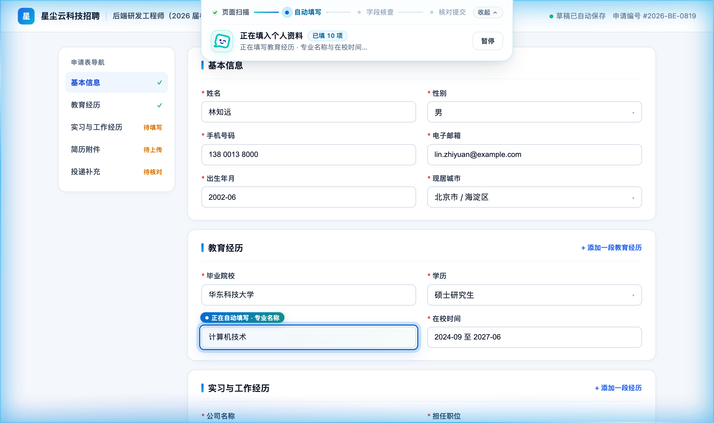
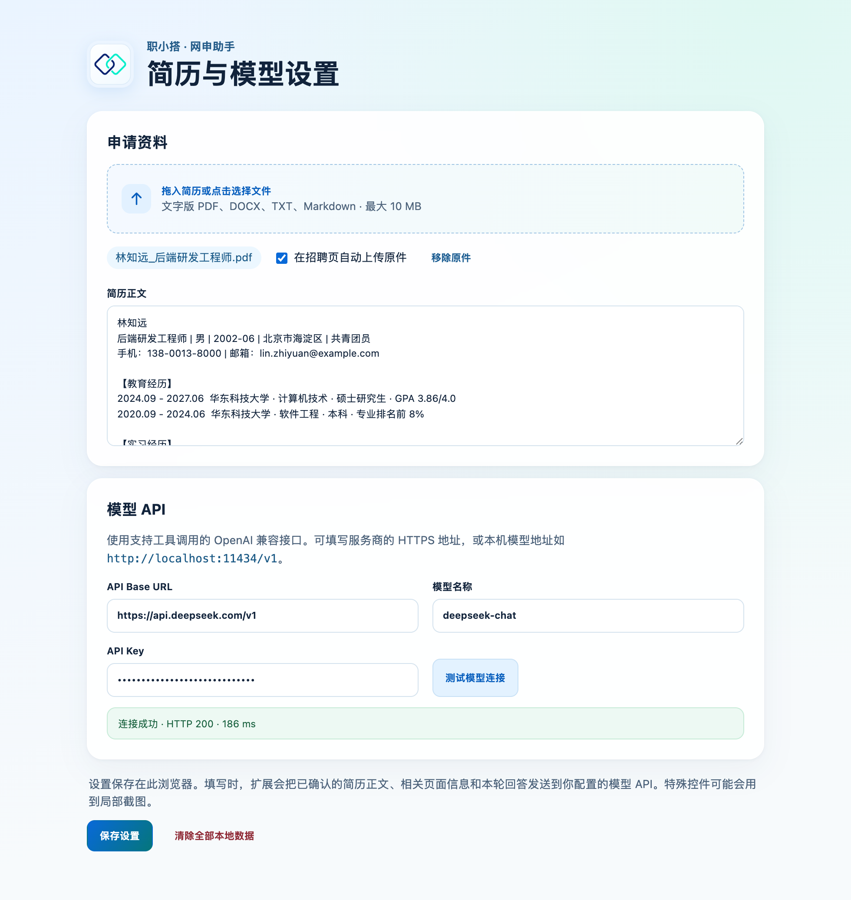
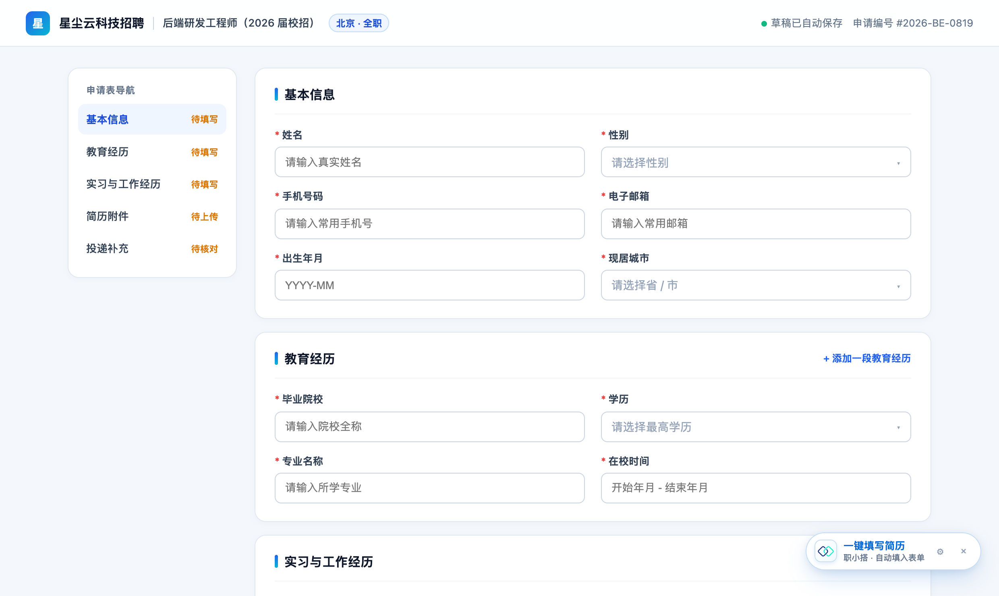
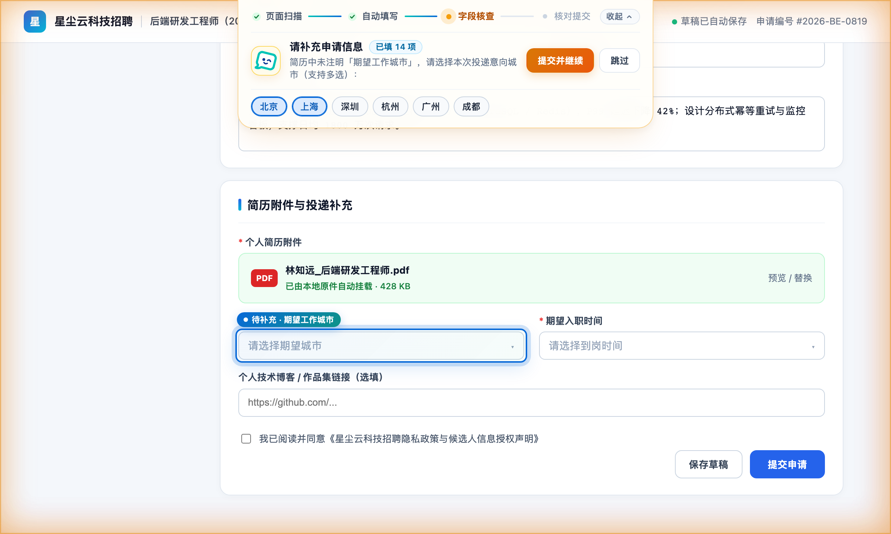
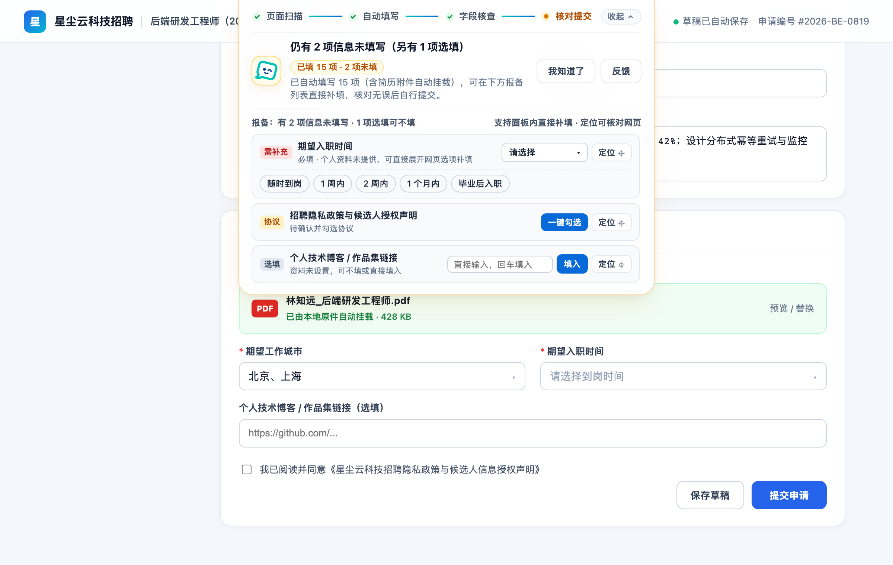

<div align="center">


# 职小搭 · 网申助手

**导入本地简历、接入自配模型，在招聘官网一键悬浮填表的 Chrome / Edge 扩展。**

自动适配复杂招聘控件与简历附件上传，写入后真实回读并独立核查遗漏，最终提交由你本人确认。

<p>
  
  
  
  
  
</p>

<p>
  <strong>简体中文</strong> · <a href="README_EN.md">English</a>
</p>

<p>
  <a href="#核心能力">核心能力</a> ·
  <a href="#界面预览">界面预览</a> ·
  <a href="#快速开始">快速开始</a> ·
  <a href="#数据与隐私">数据与隐私</a> ·
  <a href="#来源与协议">来源与协议</a>
</p>

<br />



</div>

---

## 为什么做职小搭 · 网申助手

网申的痛点不在普通文本框，而在跨十年日历面板、虚拟滚动下拉、多级级联城市、动态增删的经历区块，以及“看着填进去了、点提交才报错”的假成功。

| | **职小搭 · 网申助手** | 传统规则 / 关键词插件 |
| :--- | :--- | :--- |
| **语义理解与控件适配** | 模型按简历事实填表，内置 Moka / 飞书 Formily / Phoenix / AntD / Element 适配 | 关键词映射，遇到自定义下拉和日期面板常失效 |
| **未知控件处理** | 按需截取局部画面与邻近 DOM 单步探索，成功后本机缓存配方下次复用 | 直接跳过或填错 |
| **防幻觉与核验** | 三层回读核验（实值 → 格式 → 语义等价）+ 独立只读整表遗漏巡检 | 单次写入，无回读校验 |
| **简历附件上传** | 自动挂载导入的 PDF / DOCX 原件，并处理解析覆盖弹窗 | 手动上传 |
| **交互与边界** | 页内悬浮卡片，缺必填项内联问答，绝不自动点击提交 | 侧栏遮挡或强行覆盖已有值 |

---

## 核心能力

- **页内悬浮交互**：识别招聘表单页自动浮现右下角「一键填写简历」胶囊；顶部毛玻璃悬浮卡展示 `页面扫描 → 自动填写 → 字段核查 → 核对提交` 四阶段进度，支持折叠为冰蓝单行胶囊，切走标签页自动暂停。
- **本地简历解析与原件自动上传**：浏览器内直接解析 PDF、DOCX、TXT、Markdown（≤ 10 MB / 8 万字）；导入 PDF / DOCX 时默认保留原件，遇到简历上传区自动挂载并收起覆盖确认弹窗。
- **复杂招聘控件适配与探索复用**：支持跨十年日历翻页、可搜索 / 虚拟下拉、级联选择、动态展开多段教育与实习经历；遇到未适配控件时进入受控单步探索，验证弹层关闭且两次回读一致后在本机记录操作配方（不存个人值），同站直接复用。
- **三层回读与独立整表核查**：适配器实值回读 → 代码层格式等价（空格 / 日期补零 / 千分位 / 级联路径）→ 语义等价判定（如 `北京` / `北京市`）；结束后执行独立只读巡检，扫描屏外区域、可读 iframe 与开放 Shadow DOM，标出遗漏必填项与校验错误。
- **面板内直接补填与脱敏诊断**：选填缺失项不弹窗打断，已有值替换前先确认；报备清单内可直接输入补填、展开网页下拉选项、一键勾选隐私协议、定位高亮网页字段，并支持一键复制脱敏诊断提交 Issue。
- **兼容任意 OpenAI Chat Completions 接口**：支持 DeepSeek、OpenAI、通义千问及本机 Ollama / vLLM 等，设置页内置连通性测试。

---

## 界面预览

<table>
  <tr>
    <td align="center" width="50%">
      
      <br /><sub><b>简历与模型设置</b> — 拖放解析 PDF/DOCX、原件自动上传与模型连通性测试</sub>
    </td>
    <td align="center" width="50%">
      
      <br /><sub><b>表单页智能浮标</b> — 自动识别招聘表，右下角一键启动填写或打开设置</sub>
    </td>
  </tr>
  <tr>
    <td align="center" width="50%">
      
      <br /><sub><b>页内问答与确认</b> — 缺失必填项内联弹出选项芯片，同步高亮目标字段</sub>
    </td>
    <td align="center" width="50%">
      
      <br /><sub><b>整表核查与面板补填</b> — 清单内直接拉取网页下拉选项、勾选协议、定位与导出诊断</sub>
    </td>
  </tr>
</table>

---

## 快速开始

### 环境要求

- **Node.js** `22.12+`、`npm`
- **Chrome / Edge** `120+`
- 支持具名工具调用（Tool Calling）的 OpenAI 兼容模型 API（特殊控件视觉探索需要多模态能力；纯文本模型可正常完成常规填表，未知控件自动转人工）

### 构建与加载

```bash
git clone https://github.com/Gongji-hub/zhixiaoda-apply.git
cd zhixiaoda-apply
npm ci
npm run build
```

1. 打开 `chrome://extensions`（Edge 为 `edge://extensions`），开启**开发者模式**。
2. 点击**加载已解压的扩展程序**，选中生成的 `dist` 目录。
3. 点击扩展图标（或在扩展图标右键选「选项」）打开**简历与模型设置**。

### 配置与使用

1. **导入简历**：拖入文字版 PDF / DOCX / TXT / Markdown 或直接粘贴正文（扫描件需先 OCR），校对后保持「在招聘页自动上传原件」勾选即可自动挂载简历附件。
2. **填写模型 API**：填入 `Base URL`、`模型名称`、`API Key`（本机免鉴权模型可留空），点**测试模型连接**确认通过后保存：
   - DeepSeek：`https://api.deepseek.com/v1`
   - OpenAI：`https://api.openai.com/v1`
   - 通义千问：`https://dashscope.aliyuncs.com/compatible-mode/v1`
   - 本机 Ollama / vLLM：`http://localhost:11434/v1` 或 `http://127.0.0.1:8000/v1`
3. **开始填表**：进入招聘申请页，点右下角浮标或工具栏图标启动；按悬浮卡核对并补齐遗漏项后自行提交。

### 运行测试

```bash
npm test
```

---

## 数据与隐私

- 简历正文、原件、API Key、进度与控件配方保存在浏览器私有 `chrome.storage.local`（`TRUSTED_CONTEXTS` 隔离），网页脚本不可访问。
- 仅在点击开始填写后，将简历正文、页面表单观察与本轮回答发往你配置的模型地址（未知控件探索会附带局部截图）；API 地址仅允许 `https://` 或本机 `localhost` / `127.0.0.1`。
- 登录、验证码、隐私条款与最终提交始终由你本人操作；设置页支持一键清除全部本地数据。

---

## 来源与协议

底层浏览器自动化源自 [Nanobrowser](https://github.com/nanobrowser/nanobrowser)（Apache-2.0），招聘组件适配参考 [OfferGo](https://github.com/Suara17/OfferGo-resume-filler-extension)（MIT）。详见 [UPSTREAM.md](UPSTREAM.md) 与 [LICENSE](LICENSE)。

Licensed under the [Apache License 2.0](LICENSE).
