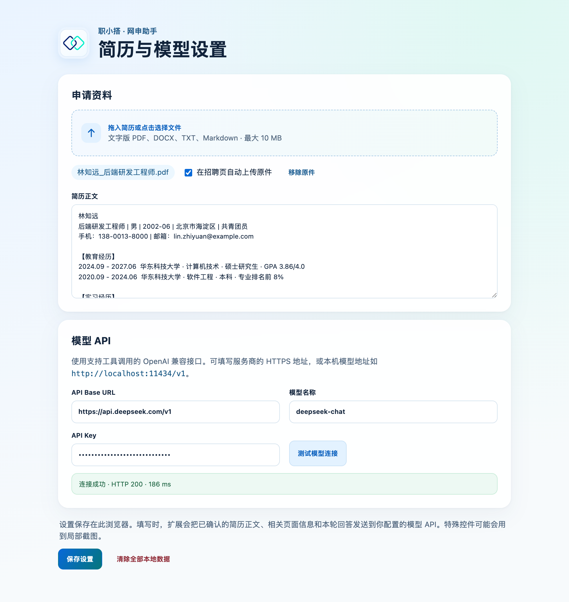
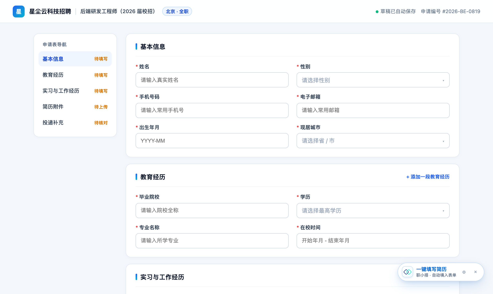
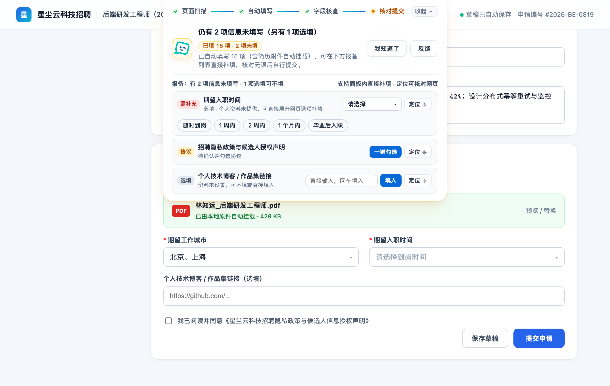

<div align="center">


# Zhixiaoda Apply

**A Chrome / Edge extension that fills complex job application forms with your own resume and OpenAI-compatible model API.**

Built-in adapters for recruiting widgets, automatic resume attachment upload, three-layer readback verification, and an independent post-fill audit — you always review and submit yourself.

<p>
  
  
  
  
  
</p>

<p>
  <a href="README.md">简体中文</a> · <strong>English</strong>
</p>

<p>
  <a href="#features">Features</a> ·
  <a href="#screenshots">Screenshots</a> ·
  <a href="#quick-start">Quick Start</a> ·
  <a href="#privacy">Privacy</a> ·
  <a href="#license">License</a>
</p>

<br />


</div>

---

## Why Zhixiaoda Apply

Recruiting portals break simple autofillers with multi-decade date pickers, virtualized dropdowns, cascading city selectors, dynamic experience blocks, and silent validation failures.

| | **Zhixiaoda Apply** | Rule / Keyword Autofillers |
| :--- | :--- | :--- |
| **Widget Coverage** | LLM-guided filling + adapters for Moka, Feishu Formily, Phoenix, AntD & Element | Basic `<input>` / `<select>` only |
| **Unknown Widgets** | Bounded visual step exploration with local recipe caching for repeat visits | Skipped or mis-filled |
| **Verification** | 3-layer readback (real DOM → format → semantic equivalence) + read-only full-form audit | Write-only |
| **Resume Upload** | Auto-attaches imported PDF / DOCX and dismisses parse-overwrite modals | Manual upload |
| **Control & Safety** | In-page floating card, inline Q&A for missing required fields, never auto-submits | Sidebars or blind overwrites |

---

## Features

- **In-Page Floating UX**: Detects recruiting forms with a bottom-right quick-launch pill; top frosted-glass card tracks 4 stages (`Scan → Fill → Verify → Review`), collapses to a single-line pill, and auto-pauses when switching tabs.
- **Local Resume Parsing & Auto-Upload**: Parses PDF, DOCX, TXT, and Markdown locally in-browser (up to 10 MB / 80k chars) and optionally auto-attaches the original PDF/DOCX into resume upload inputs.
- **Recruiting Adapters & Unknown-Control Recipes**: Handles multi-decade calendars, searchable/virtual dropdowns, cascaders, and dynamic experience rows; explores unfamiliar widgets step-by-step and caches sanitized local recipes (without personal values) for reuse.
- **Three-Layer Readback & Independent Audit**: Combines adapter readback, deterministic format checks, and semantic equivalence checks, followed by a separate read-only DOM audit across off-screen sections, accessible iframes, and open Shadow DOM.
- **Inline Completion & Sanitized Diagnostics**: Leaves missing optional fields blank, confirms before overwriting existing values, lets you pick live dropdown options or check consent right inside the card, and copies sanitized diagnostics for GitHub Issues.
- **Any OpenAI-Compatible API**: Works with DeepSeek, OpenAI, Qwen, local Ollama / vLLM, and more, with a built-in Settings connection tester.

---

## Screenshots

<table>
  <tr>
    <td align="center" width="50%">
      
      <br /><sub><b>Resume &amp; Model Settings</b> — Drag-and-drop PDF/DOCX import, auto-upload toggle &amp; connection tester</sub>
    </td>
    <td align="center" width="50%">
      
      <br /><sub><b>Smart Floating Pill</b> — Surfaces on recruiting forms for one-click fill or quick Settings access</sub>
    </td>
  </tr>
  <tr>
    <td align="center" width="50%">
      
      <br /><sub><b>Inline Q&amp;A &amp; Confirmation</b> — Prompts for missing required fields with selectable chips and field highlight</sub>
    </td>
    <td align="center" width="50%">
      
      <br /><sub><b>Audit &amp; Inline Fix</b> — Fetch live dropdown options, check consent, locate fields &amp; export diagnostics</sub>
    </td>
  </tr>
</table>

---

## Quick Start

### Prerequisites

- **Node.js** `22.12+` and `npm`
- **Chrome / Edge** `120+`
- An OpenAI-compatible `/chat/completions` API supporting named tool calls (vision is optional for unknown-control exploration; text-only models handle standard forms normally)

### Build & Install

```bash
git clone https://github.com/Gongji-hub/zhixiaoda-apply.git
cd zhixiaoda-apply
npm ci
npm run build
```

1. Open `chrome://extensions` (or `edge://extensions`) and enable **Developer mode**.
2. Click **Load unpacked** and select `dist`.
3. Click the extension icon (or right-click → **Options**) to open **Settings**, drop your resume, enter your API `Base URL`, `Model`, and `API Key`, test the connection, and save.

### Run Tests

```bash
npm test
```

---

## Privacy

- Resume text, original file bytes, API keys, checkpoints, recipes, and diagnostics stay in `chrome.storage.local` (`TRUSTED_CONTEXTS`).
- Data is sent only to your configured model endpoint (`https://` or local `localhost` / `127.0.0.1`) when you start filling.
- Login, CAPTCHAs, consent, and final submission stay manual; Settings provides one-click local data wipe.

---

## License

Built on [Nanobrowser](https://github.com/nanobrowser/nanobrowser) (Apache-2.0) with recruiting widget references from [OfferGo](https://github.com/Suara17/OfferGo-resume-filler-extension) (MIT). See [UPSTREAM.md](UPSTREAM.md) and [LICENSE](LICENSE).
