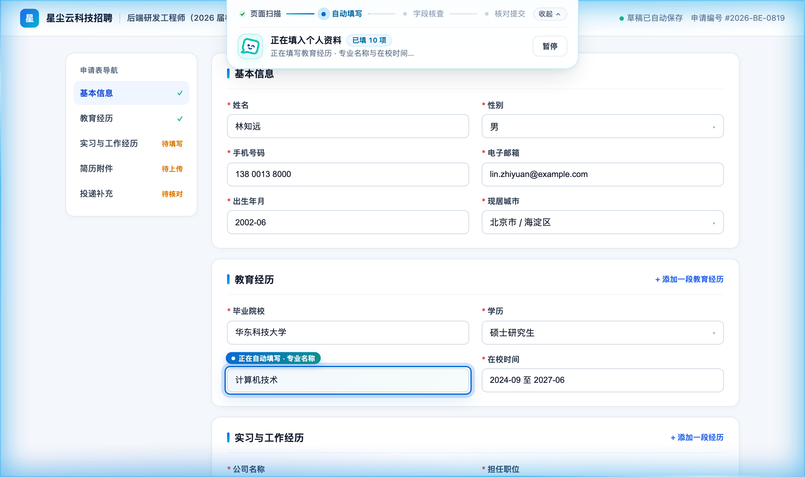

<div align="center">


# Zhixiaoda Apply

**A Chrome / Edge extension that fills job application forms with your local resume and OpenAI-compatible model API.**

<p>
  
  
  
</p>

<p>
  <a href="README.md">简体中文</a> · <strong>English</strong>
</p>

<p>
  <a href="#features">Features</a> ·
  <a href="#screenshots">Screenshots</a> ·
  <a href="#quick-start">Quick Start</a> ·
  <a href="#privacy">Privacy</a> ·
  <a href="#license">License</a>
</p>

<br />



</div>

---

## Features

- **In-page floating UI**: Surfaces a bottom-right launch pill on recruiting forms and tracks progress in a collapsible top card; auto-pauses when you switch tabs.
- **Recruiting widget adapters**: Handles date pickers, searchable/virtual dropdowns, cascaders, and dynamic experience rows across Moka, Feishu Formily, Phoenix, Ant Design, and Element; explores unfamiliar widgets via local crop screenshots and caches verified step recipes per site.
- **Readback & missing-field audit**: Reads back DOM values and validation errors after filling, then runs a separate read-only scan across off-screen sections, accessible iframes, and open Shadow DOM to catch missed required fields.
- **Local resume parsing & upload**: Parses text-based PDF, DOCX, TXT, and Markdown in-browser (≤ 10 MB / 80k chars) and auto-attaches imported PDF/DOCX files into resume upload inputs while dismissing overwrite popups.
- **Human-in-the-loop**: Prompts inline for missing required fields or existing-value overwrites, leaves missing optional fields blank, supports inline dropdown picking and consent checking in the post-fill checklist, and never clicks Submit for you.

---

## Screenshots

<table>
  <tr>
    <td align="center" width="50%">
      
      <br /><sub><b>Settings</b> — Drag-and-drop resume import, auto-upload toggle &amp; API test</sub>
    </td>
    <td align="center" width="50%">
      
      <br /><sub><b>Floating Launch Pill</b> — One-click start or quick Settings access on forms</sub>
    </td>
  </tr>
  <tr>
    <td align="center" width="50%">
      
      <br /><sub><b>Inline Q&amp;A</b> — Prompt for missing required values with field highlight</sub>
    </td>
    <td align="center" width="50%">
      
      <br /><sub><b>Review &amp; Inline Fix</b> — Pick live dropdowns, check consent, locate &amp; copy diagnostics</sub>
    </td>
  </tr>
</table>

---

## Quick Start

Requires **Node.js 22.12+**, **Chrome / Edge 120+**, and an OpenAI-compatible API supporting Tool Calling.

```bash
git clone https://github.com/Gongji-hub/zhixiaoda-apply.git
cd zhixiaoda-apply
npm ci
npm run build
```

1. Open `chrome://extensions` (or `edge://extensions`), enable **Developer mode**, and load the generated `dist` directory.
2. Click the extension icon to open Settings: import or paste your resume, enter your `API Base URL` (e.g. `https://api.openai.com/v1` or `http://localhost:11434/v1`), `Model`, and optional `API Key`, test the connection, and save.
3. Open a recruiting form, click the bottom-right pill or toolbar icon to start, review the checklist, and submit manually.

> Unknown-control exploration requires a vision-capable model; text-only models fill standard forms normally and defer bespoke controls to the checklist. Run `npm test` to execute unit tests.

---

## Privacy

- Resumes, file attachments, API keys, checkpoints, control recipes, and diagnostics stay in `chrome.storage.local` (`TRUSTED_CONTEXTS`), isolated from webpage scripts.
- Data is sent only to your configured model endpoint (`https://` or local `localhost` / `127.0.0.1`) during active runs (local crop screenshots only when exploring unknown controls).
- Settings includes a one-click wipe for all local data. Diagnostic summaries copied from the card redact long IDs/emails from URLs and exclude resume values.

---

## License

Built on [Nanobrowser](https://github.com/nanobrowser/nanobrowser) (Apache-2.0) with widget references from [OfferGo](https://github.com/Suara17/OfferGo-resume-filler-extension) (MIT). See [UPSTREAM.md](UPSTREAM.md) and [LICENSE](LICENSE).
